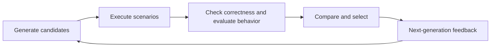

# Population-Based Algorithm Evolution

English | [简体中文](docs/README.zh-CN.md)

A research framework for generating, testing, and evolving algorithms with large language models. Models judge behavior from task descriptions and evidence collected through actual interaction; the framework manages candidate code, test scenarios, evaluation feedback, and population evolution.

The project targets algorithm optimization tasks that require interaction with external environments and lack an explicit numerical fitness function. It currently includes a UAV adversarial navigation problem and a port route planning scaffold awaiting simulator integration.



## Features

- Population-based algorithm search with repair, crossover, and mutation operators.
- Separate execution and constraint failures from weak behavioral performance, with diagnoses used for repair in the next generation.
- Test parents and offspring on a common scenario suite, then select using multiple analysts and pairwise comparisons.
- Archive candidate code, model interactions, execution evidence, and evaluation records; resume from committed generations.
- Integrate problems through shared interfaces while keeping environment interaction and candidate isolation inside each problem's simulator.

| Problem | Status |
| --- | --- |
| [UAV adversarial navigation](problems/uav_adversarial/problem.yaml) | ProjectAirSim adapter implemented; start the UE5 environment manually |
| [Port route planning](problems/port_route_planning/problem.yaml) | Configuration and interface scaffold; full runs abort explicitly until the simulator is connected |

## Repository layout

```text
evolution/
  generation/       # Code generation and evolution operators
  testing/          # Scenario generation, execution, retries, and records
  evaluation/       # Diagnosis, behavioral analysis, comparison, and selection
  framework.py      # Shared problem and simulator interfaces
  runner.py         # Generation orchestration and recovery
  storage.py        # Experiment artifacts and population commits
problems/
  uav_adversarial/   # UAV adversarial navigation
  port_route_planning/
requirements.txt
```

Each problem owns its `problem.yaml`, `spec.py`, `simulator.py`, and algorithm template. The top-level `problem_id` is the sole problem identifier; `task` defines the goal, inputs, outputs, and constraints.

## Installation

Run commands from the repository root. The framework uses Linux file locking. Python 3.8 is recommended for the UAV problem to match the current ProjectAirSim 0.1.1 SDK.

```bash
python3.8 -m venv .venv
source .venv/bin/activate
python -m pip install -r requirements.txt
```

UAV candidate isolation also requires `bubblewrap`, `prlimit`, and `/usr/bin/python3`. On Debian or Ubuntu:

```bash
sudo apt-get install bubblewrap util-linux
```

If the ProjectAirSim source is at `~/ProjectAirSim`, install its client in the same virtual environment. These commands install the core dependencies used by the flight adapter, bypassing full resolution of the SDK's older visualization dependencies:

```bash
python -m pip install --no-deps -e "$HOME/ProjectAirSim/client/python/projectairsim"
python -m pip install pynng msgpack cryptography commentjson jsonschema pykml \
  'setuptools<81' opencv-python-headless pqdict
```

## Model configuration

Configure these sections in the problem's `problem.yaml`:

- `models`: service endpoints, model names, timeouts, and request parameters.
- `agents`: model profiles assigned to generation, testing, analysis, and judging roles.

The framework uses the OpenAI-compatible Chat Completions interface with remote services or a local vLLM server. The service must support the configured `json_object` or `json_schema` output mode.

Create `.env` in the repository root:

```dotenv
LLM_CLOUD_API_KEY_ENV=OPENAI_API_KEY
OPENAI_API_KEY=replace-with-your-cloud-key

LLM_LOCAL_API_KEY_ENV=VLLM_API_KEY
VLLM_API_KEY=local-development
```

`LLM_CLOUD_API_KEY_ENV` and `LLM_LOCAL_API_KEY_ENV` name the environment variables containing the corresponding keys. Configure credentials for the profiles you actually use. Existing process environment variables take precedence over `.env`; a local service's key must match its server configuration.

Git ignores `.env`. Keep credentials in environment variables or the root `.env`, outside the archived `problem.yaml`.

## Run an experiment

Configure model access and start UE5 / ProjectAirSim manually, then run:

```bash
source .venv/bin/activate
python -m evolution run --problem uav_adversarial --run-id uav_001
```

Set the experiment size in the problem configuration. This is a small example; the corresponding `problem.yaml` determines the actual settings:

```yaml
experiment:
  population_size: 4
  generations: 2
  seed: 42

genetics:
  crossover_probability: 0.5
  mutation_probability: 0.5
  elite_count: 1
```

`population_size` is the number of retained candidates per generation. `generations: 2` runs two evolution rounds after the initial generation, `gen_0000`. Each subsequent round generates P offspring, tests and evaluates them alongside P parents, and retains P candidates. `elite_count` must be smaller than P, and crossover and mutation probabilities must sum to 1.

Other commands accept the same `--problem` and `--run-id` arguments:

| Command | Purpose |
| --- | --- |
| `python -m evolution prepare` | Save configuration and source snapshots without calling models or checking simulator readiness |
| `python -m evolution generate` | Generate candidates without executing tests |
| `python -m evolution build-suite` | Construct a scenario suite without executing candidates |
| `python -m evolution run` | Run the complete optimization process |

`generate` and `build-suite` require a working model service. The default problem is `port_route_planning`; specify `--problem uav_adversarial` for UAV experiments.

Reuse the same `run-id` with unchanged configuration and source code to resume from committed generations. Use a new `run-id` after changing problem configuration, problem implementation, or framework code.

## Evolution and evaluation

Each generation slot produces one candidate. Failures discovered in a generation do not trigger repair and rerun within that generation. Each failed parent retained from the previous generation receives one repair offspring; remaining slots use crossover or mutation among healthy parents. With only one healthy parent, these slots use mutation.

Execution failures, invalid outputs, hard-constraint violations, and missing evidence receive failure diagnoses. Candidates that pass checks proceed to behavioral analysis, cross-review, and pairwise preference comparison. Infrastructure failures receive bounded retries; exhausted retries abort the run rather than becoming algorithm performance judgments.

Selection prioritizes candidates that pass checks. If fewer than P qualify, failed candidates may fill the remaining places for repair in the next generation. Each eligible pair is compared in both orders, so evaluation requests grow approximately quadratically with the eligible population. Choose the experiment size with model cost and simulation time in mind.

The final output is a recommendation supported by the current test suite. Ties, incomparability, and preference cycles remain explicit; the framework does not guarantee a unique or globally optimal algorithm.

## UAV adversarial navigation

The environment contains one tested UAV and one to four adversarial UAVs. The tested UAV uses a fixed PD+CBF navigator to reach its goal. Optimization targets one shared decision policy for all adversarial UAVs.

- Adversarial intensity is a scalar in `[0, 1]`. Higher intensity should cause greater delay, diversion, or departure of the tested UAV from the airspace.
- The tested UAV may be forced outside the boundary. Adversaries must remain inside, and all UAVs must avoid collisions.
- All initial positions must be inside the airspace, with every pair strictly more than 1 m apart.
- Core scenarios cover one to four adversaries and matched initial conditions at intensities `0`, `0.5`, and `1`.
- Evaluation uses the task and actual interaction evidence without importing the original adversarial project's reward functions or numerical performance metrics.

Algorithms implement `solve(observation, seed)`, consume observations collected by the simulator, and return N acceleration vectors. Generated code uses only the Python standard library and runs in an isolated subprocess. See the [algorithm template](problems/uav_adversarial/template/algorithm.py.txt) for the interface.

Every control step records requested and applied accelerations and the resulting flight state, with initial and terminal states retained. Behavioral analysis and candidate comparisons receive the complete step-by-step records.

Connection and decision timeout settings belong in `execution.environment`:

```yaml
address: 127.0.0.1
port_topics: 8989
port_services: 8990
decision_timeout_seconds: 1.0
```

All candidates, scenarios, and intensities in a generation's testing batch share one connection. Each intensity flight reloads and initializes the scene. When testing completes or aborts, the adapter disconnects and cleans up local resources without landing. The next generation reconnects and reloads the scene. Disconnecting alone does not reset or stop the UE scene.

The framework treats UE5/ProjectAirSim as a nondeterministic external simulator. Small differences in vehicle state, physics updates, and asynchronous communication timing can produce different trajectories even when source code, scenario inputs, and random seed are unchanged. The framework seed does not guarantee reproducibility of the complete external simulation.

Parents and offspring are therefore rerun on the common scenario suite in every generation. Behavioral analysis and comparison use the current execution evidence rather than treating a historical trajectory as a new execution result.

After changing the UAV simulator, constraints, template, or simulation configuration, update `execution.harness_hash` and use a new `run-id`:

```bash
python -c 'from problems.uav_adversarial.simulator import harness_hash; print(harness_hash())'
```

## Inspect results

Artifacts are saved under `runtime_data/<problem_id>/<run_id>/`:

```text
config/                    # Configuration and source snapshot indexes
individuals/<id>/code/      # Each candidate's algorithm.py
individuals/<id>/           # Metadata, parent relationships, and changes
generations/               # Per-generation production, testing, and evaluation
populations/               # Committed populations and recovery pointers
memory/                    # Reviewed feedback for subsequent generations
objects/                   # Execution evidence, logs, and snapshot objects
final/best.json            # Final recommendation and its basis
final/algorithm.py         # Exported code when an eligible candidate exists
experiment_manifest.json   # Overall status, progress, eligible IDs, abort reason
```

Model requests and responses, failure diagnoses, test trajectories, and comparisons are archived in the experiment directory. `COMPLETED` means that the process finished, not that a usable algorithm was found. If no final candidate qualifies, `final/best.json` records `NO_VALID_CANDIDATE` and no recommendation code is exported.

## Add a problem

Provide these files under `problems/<problem_id>/` and configure their component references in `problem.yaml`:

| File | Responsibility |
| --- | --- |
| `problem.yaml` | Task, model roles, experiment settings, scenario space, and evaluation principles |
| `spec.py` | Scenario validation, correctness checks, and feedback sanitization |
| `simulator.py` | Environment interaction, candidate isolation, state collection, and evidence recording |
| `template/algorithm.py.txt` | Algorithm entry point, input/output contract, and starting implementation |

Implement the [Simulator interface](evolution/framework.py): `check_readiness(config)`, `run(code_directory, scenario, config)`, and the `sandboxed` attribute. The executor executes every candidate/scenario combination and saves its record; environment-specific control stays inside the problem directory.

Adapters that reuse resources within a generation may provide an optional `testing_batch(config)` context manager. The executor wraps the generation's tests in that context, triggering cleanup on both normal completion and exceptional exit. Adapters without it retain per-call execution behavior.

The framework's module organization draws on [LACE](https://github.com/PJ-NTU/LACE). UAV model configuration and some navigation and initialization conventions originate from ACIAT-UAV; its training code is not a runtime dependency.
