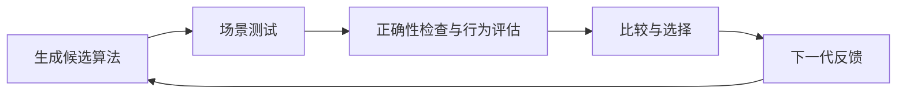

# Population-Based Algorithm Evolution

一个通过大语言模型生成、测试和迭代优化算法的研究框架。模型根据任务描述与实际交互证据判断算法表现，框架负责管理候选代码、测试场景、评估反馈和种群演化。

项目面向需要与外部环境交互、缺少明确数值评价函数的算法优化任务。当前提供无人机对抗导航问题，以及待接入仿真器的港口路径规划骨架。



## 主要功能

- 基于种群进行算法搜索，支持修复、交叉和变异算子。
- 区分执行或约束失败与行为表现较弱，失败诊断用于下一代修复。
- 使用公共场景集测试父代和子代，结合多分析员评审及成对比较进行选择。
- 保存候选源码、模型交互、执行证据和评估记录，支持从已提交的代际结果恢复运行。
- 通过统一接口接入不同问题，由问题自己的仿真器负责实际交互与候选代码隔离。

| 问题 | 状态 |
| --- | --- |
| [无人机对抗导航](problems/uav_adversarial/problem.yaml) | 已接入 ProjectAirSim，需要手动启动 UE5 仿真环境 |
| [港口路径规划](problems/port_route_planning/problem.yaml) | 配置与接口骨架；仿真器尚未接入，完整运行会明确中止 |

## 项目结构

```text
evolution/
  generation/       # 代码生成与演化算子
  testing/          # 场景生成、执行、重试与缓存
  evaluation/       # 诊断、行为分析、比较与选择
  framework.py      # 问题与仿真器的统一接口
  runner.py         # 代际流程调度与恢复
  storage.py        # 实验记录与种群提交
problems/
  uav_adversarial/   # 无人机对抗导航
  port_route_planning/
requirements.txt
```

每个问题在自己的目录中维护 `problem.yaml`、`spec.py`、`simulator.py` 和算法模板。顶层 `problem_id` 是唯一的问题标识，`task` 描述目标、输入输出和约束。

## 安装

从仓库根目录执行命令。框架使用 Linux 文件锁；无人机问题建议使用 Python 3.8，以适配当前 ProjectAirSim 0.1.1 SDK。

```bash
python3.8 -m venv .venv
source .venv/bin/activate
python -m pip install -r requirements.txt
```

无人机算法隔离运行还需要 `bubblewrap`、`prlimit` 和 `/usr/bin/python3`。在 Debian / Ubuntu 上可安装：

```bash
sudo apt-get install bubblewrap util-linux
```

如果 ProjectAirSim 源码位于 `~/ProjectAirSim`，在同一虚拟环境中安装客户端。以下命令安装当前飞行适配器使用的核心依赖，跳过 SDK 中旧版可视化依赖的完整解析：

```bash
python -m pip install --no-deps -e "$HOME/ProjectAirSim/client/python/projectairsim"
python -m pip install pynng msgpack cryptography commentjson jsonschema pykml \
  'setuptools<81' opencv-python-headless pqdict
```

## 模型配置

在对应问题的 `problem.yaml` 中设置：

- `models`：模型服务地址、模型名称、超时和请求参数。
- `agents`：生成、测试、分析和评判等角色使用的模型配置。

框架通过 OpenAI 兼容的 Chat Completions 接口调用模型，可连接远程服务或本地 vLLM。模型服务需要支持配置中指定的 `json_object` 或 `json_schema` 输出模式。

在仓库根目录创建 `.env`：

```dotenv
LLM_CLOUD_API_KEY_ENV=OPENAI_API_KEY
OPENAI_API_KEY=replace-with-your-cloud-key

LLM_LOCAL_API_KEY_ENV=VLLM_API_KEY
VLLM_API_KEY=local-development
```

`LLM_CLOUD_API_KEY_ENV` 和 `LLM_LOCAL_API_KEY_ENV` 指定密钥所在的环境变量名称。只配置实际使用的模型角色所需的凭据即可；进程中已有的环境变量优先于 `.env`。使用本地服务时，密钥应与服务端设置一致。

`.env` 已被 Git 忽略。密钥应保存在环境变量或根目录 `.env` 中，不要放入会被实验归档的 `problem.yaml`。

## 运行优化

先完成模型配置，并手动启动 UE5 / ProjectAirSim，然后运行：

```bash
source .venv/bin/activate
python -m evolution run --problem uav_adversarial --run-id uav_001
```

实验规模在问题配置中设置。下面是一个小规模示例，实际运行以对应的 `problem.yaml` 为准：

```yaml
experiment:
  population_size: 4
  generations: 2
  seed: 42

genetics:
  crossover_probability: 0.5
  mutation_probability: 0.5
  elite_count: 1
```

`population_size` 表示每代保留的算法数量。`generations: 2` 表示初始代 `gen_0000` 之后再迭代两代；后续每代生成 P 个子代，与 P 个父代共同测试、评估，再保留 P 个候选。`elite_count` 必须小于 P，交叉与变异概率之和必须为 1。

其他命令使用相同的 `--problem` 和 `--run-id` 参数：

| 命令 | 用途 |
| --- | --- |
| `python -m evolution prepare` | 保存配置与源码快照，不调用模型或检查仿真服务 |
| `python -m evolution generate` | 仅生成候选代码，不执行测试 |
| `python -m evolution build-suite` | 仅构建测试场景 |
| `python -m evolution run` | 执行完整优化流程 |

`generate` 和 `build-suite` 需要可用的模型服务。命令默认问题是 `port_route_planning`，运行无人机问题时需显式指定 `--problem uav_adversarial`。

保持配置与源码不变，使用相同 `run-id` 可从已提交的代际结果恢复。修改问题配置、问题实现或框架源码后，应使用新的 `run-id`。

## 演化与评估规则

每个生成名额产出一个候选，当前代发现的失败不会触发同代修复重跑。上一代被保留的失败候选各获得一个修复子代；其余名额在正常父代之间执行交叉或变异。只有一个正常父代时使用变异。

执行失败、输出不合规、违反硬约束或缺少有效证据的候选会收到失败诊断。通过检查的候选进入行为分析、交叉评审和成对偏好比较。基础设施故障由有限重试处理，重试耗尽后中止运行，不作为算法表现评分。

选择优先保留通过检查的候选。有效候选不足 P 个时，剩余位置可保留失败候选，供下一代修复。每对有效候选按正反顺序分别比较一次；评估请求数量随有效候选数量近似按平方增长，实验规模应结合模型调用成本和仿真耗时设置。

最终输出是当前测试集支持的推荐结果。框架保留平局、不可比和偏好环等情况，不保证找到唯一或全局最优算法。

## 无人机对抗导航

环境包含 1 架被测无人机和 1～4 架对抗无人机。被测无人机使用固定 PD+CBF 导航算法前往目标点；优化对象是所有对抗无人机共用的决策算法。

- 对抗强度为 `[0, 1]` 标量，目标是使更高强度产生更明显的延误、绕行或被测无人机出界。
- 允许被测无人机被挤出边界；对抗无人机必须保持在规定空域内，所有无人机禁止碰撞。
- 初始化时所有无人机位于空域内，任意两架间距严格大于 1 m。
- 核心场景覆盖 1～4 架对抗无人机，并使用相同初始条件测试强度 `0`、`0.5` 和 `1`。
- 评价依据任务描述及实际交互证据，不导入原对抗项目的奖励函数或数值性能指标。

算法实现 `solve(observation, seed)`，接收仿真器获取的观测，返回 N 个加速度向量。生成代码只允许使用 Python 标准库，在隔离子进程中执行。接口细节见[算法模板](problems/uav_adversarial/template/algorithm.py.txt)。

每个控制步都记录请求与实际应用的加速度，以及该步结束后的飞行状态，并保留初始化和终止状态。行为分析与候选比较接收完整的逐步记录。

连接和决策超时配置位于 `execution.environment`：

```yaml
address: 127.0.0.1
port_topics: 8989
port_services: 8990
decision_timeout_seconds: 1.0
```

一个 gen 的全部候选、场景和对抗强度测试共用连接；每次强度测试重载场景并初始化。该代测试完成或异常退出时，仅断开连接和清理本地资源，不执行降落。下一代重新连接、重载场景。断开连接本身不会重置或停止 UE 场景。

实际飞行具有非确定性，因此该问题禁用执行缓存，每代在公共场景集上重新测试父代与子代。

修改 UAV 仿真器、约束、模板或仿真配置后，需要更新 `execution.harness_hash`，并使用新 `run-id`：

```bash
python -c 'from problems.uav_adversarial.simulator import harness_hash; print(harness_hash())'
```

## 查看结果

运行记录保存到 `runtime_data/<problem_id>/<run_id>/`：

```text
config/                    # 配置与源码快照索引
individuals/<id>/code/     # 各候选的 algorithm.py
individuals/<id>/          # 元数据、父代关系及修改记录
generations/               # 每代的生成、测试与评估记录
populations/               # 已提交的种群与恢复指针
memory/                    # 供后续代使用的评审反馈
objects/                   # 执行证据、日志与快照等内容对象
final/best.json            # 最终推荐结果与依据
final/algorithm.py         # 存在合格候选时导出的推荐代码
experiment_manifest.json   # 整体状态、进度、可用候选与中止原因
```

模型请求和回复、失败诊断、测试轨迹及比较记录都保存在实验目录中。`COMPLETED` 表示流程已完成，不保证存在可用算法；若最终没有合格候选，`final/best.json` 会记录 `NO_VALID_CANDIDATE`，不会导出推荐代码。

## 接入新问题

在 `problems/<problem_id>/` 下提供以下内容，并通过 `problem.yaml` 指定组件：

| 文件 | 职责 |
| --- | --- |
| `problem.yaml` | 任务、模型角色、实验参数、场景空间与评价原则 |
| `spec.py` | 场景合法性检查、结果正确性检查和反馈整理 |
| `simulator.py` | 环境交互、算法执行隔离、状态采集及证据记录 |
| `template/algorithm.py.txt` | 算法入口、输入输出约定与初始实现 |

仿真器实现 [Simulator 接口](evolution/framework.py) 的 `check_readiness(config)`、`run(code_directory, scenario, config)` 以及 `sandboxed`、`deterministic` 属性。执行记录和缓存由 executor 统一管理；具体环境控制逻辑保留在问题目录中。

需要在一代测试期间复用资源的仿真器，可以提供可选的 `testing_batch(config)` 上下文管理器。executor 在本代全部测试外使用该上下文，正常结束和异常退出均触发清理；未实现此接口的问题沿用逐次执行流程。

框架模块划分参考 [LACE](https://github.com/PJ-NTU/LACE)。无人机模型配置及部分导航、环境初始化约定来自 ACIAT-UAV；运行时不依赖其训练代码。
